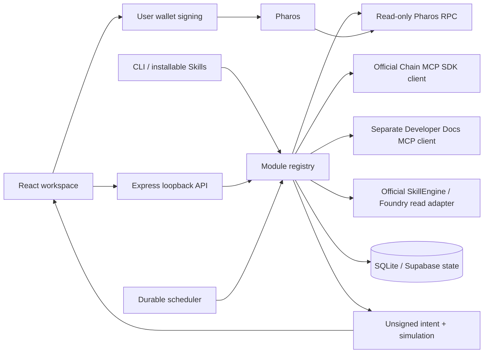

# Architecture

The catalog stores identity, exact screenshot title, fields and dependencies. The backend registry lazily loads `backend/src/modules/<id>.js`. Each module exports `schema` and `execute(ctx,input)`. `Runner` validates, assigns idempotency keys, records input/results/errors, and controls concurrency. The UI lazy-loads the workspace renderer; module-specific fields and handlers avoid unrelated controls while retaining common layout.

`Store` uses WAL and synchronous SQLite transactions for small local state changes. On Vercel, when `SUPABASE_URL` and `SUPABASE_SERVICE_ROLE_KEY` are configured, each API invocation hydrates the same state from the private Supabase tables and persists its resulting changes before the function completes. This keeps execution history, monitor cursors, payment records, schedules and audit evidence across serverless instance recycling. Events retain unique IDs and execution request keys retain their idempotency constraint. Run [`supabase.sql`](supabase.sql) before enabling this mode.

C08 composition: user request → verify installed official SkillEngine/Foundry → verify Chain MCP chain → read live data via Chain MCP → run application threshold Skill logic → persist per-condition trace. The Skill package's documented JavaScript interaction-script convention is used; no nonexistent remote runtime API is invented.

C09 composition: input function/ABI → team-confirmed Dev Docs query containing the same function signature → require source references → encode/call that function via Chain MCP → decode and explain output position/units with citations. Missing sources stop the chain call. The default uses the working official llms.txt index and canonical pages; a separate MCP transport remains optional.

C16 routing: query each ERC-4626 adapter independently → retain per-venue failures → require comparable underlying asset → check capacity → rank asset-equivalent previews → explain choice → prepare exact-amount approval if needed, otherwise deposit/withdraw → user signature. Shares from different vaults are never compared directly. Query results expose positions and current conversion rates; rates are not represented as forecast APR.

Transaction state is separate from execution success. An API run can successfully report a denied policy or failed simulation. An intent is only confirmed after matching its actual transaction and a successful receipt with three confirmations. Sagas wait at each step and compensate completed steps in reverse order. Missing compensation produces explicit manual-recovery state.

For a free demonstration deployment, GitHub Actions calls the protected `/api/cron/tick` endpoint every 15 minutes. That endpoint uses the persisted job list and runs due monitor jobs once. Scheduler invocations can be delayed by free hosting services; multiple-worker production scheduling, deep reorg reconciliation and multi-tenant account isolation remain outside this delivered scope. Public self-hosting uses one authenticated administrator workspace; remote multi-user operation requires a separate authorization and tenancy design.

## Product interfaces and access

Each feature has dedicated structured controls, browser-persisted draft input, per-feature execution history, and local monitor/schedule controls. Results and wallet intents can be reopened from that feature’s history. The supplied JPEG logo is rendered unchanged with white-canvas cropping. Admin authentication supports self-hosting behind TLS; the default remains loopback until configured.
